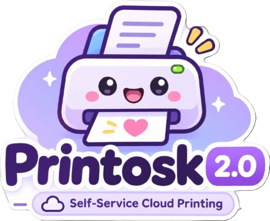

<p align="center">
  
</p>

<h1 align="center">🌸 Printosk 2.0 — Autonomous Cloud Printing Kiosk 🖨️</h1>

<p align="center">
  <b>A completely cloud-connected, QR-authorized self-service printing kiosk designed for schools, universities, and commercial campuses.</b>
  <br />
  <i>Zero Raspberry Pis. Zero secondary microcontrollers. Zero physical keypads. Zero screens on the kiosk.</i>
</p>

<p align="center">
  <a href="https://github.com/DebugDroid-15/Printosk"></a>
  
  
  
  
  
</p>

---

## 📖 1. System Overview

**Printosk 2.0** reimagines self-service document printing. Traditional printing kiosks rely on bulky desktop PCs, expensive Raspberry Pis, fragile physical keypads, and tiny OLED screens that frequently break down in public areas.

**Printosk 2.0 eliminates all of that:**
- The physical kiosk contains only an **ESP32-S3 N16R8** microcontroller wired directly to an **Epson EcoTank L3115** printer via **native USB Host OTG (D+/D-)**.
- The customer interacts **100% through their smartphone**: they scan the permanent QR code sticker on the kiosk, open the mobile web page, enter their 6-digit Job ID, and the document prints immediately.
- The cloud handles heavy document conversion (rasterizing PDF to Epson ESC/P-R raster streams), keeping the ESP32 fast, stable, and immune to memory exhaustion.

---

## 🎨 2. Live Student & Campus Experience

| Screen | Description | URL / Route |
| :--- | :--- | :--- |
| **Kawaii Landing Page** | Friendly campus theme with mascot illustration, clear 3-step workflow, and pricing transparency. | `/` |
| **Upload & Pricing Configurator** | Drag-and-drop PDF upload with instant page counting, B&W (₹1.50) vs. Colour (₹5.00) toggle, and copy selector. | `/upload` |
| **Razorpay Checkout Modal** | Official Razorpay popup supporting UPI (GPay, PhonePe, Paytm), NetBanking, and Cards. | Integrated in `/upload` |
| **Payment Success & Job Pass** | Displays the secret 6-digit Job ID (`PSK-XXXXXX`), copy button, and a 60-minute expiry countdown. | `/payment-success` |
| **QR Kiosk Touch Interface** | Mobile-first virtual numeric keypad designed for scanning students at the physical kiosk. | `/kiosk/[kioskCode]` |
| **Admin Fleet Command Center** | Real-time WebSocket monitoring of physical kiosks, paper levels, online/offline detection, and live revenue. | `/admin` |

---

## ⚡ 3. Hardware Architecture & Wiring

The kiosk controller is an **ESP32-S3 N16R8** (16MB Flash, 8MB Octal PSRAM) utilizing its internal USB Full-Speed OTG peripheral.

### Complete 4-Wire Connection Diagram:
```
  ESP32-S3 DevKit Pin                      USB Cable to Epson L3115
  ──────────────────────────────────────────────────────────────────
  5V (or VIN) Pin       ─────────────► Pin 1 (VBUS - Red wire)
  GPIO 19               ─────────────► Pin 2 (D- - White wire)
  GPIO 20               ─────────────► Pin 3 (D+ - Green wire)
  GND Pin               ─────────────► Pin 4 (GND - Black wire)
  
  GPIO 48 (Onboard)     ─────────────► WS2812 NeoPixel Status LED
  GPIO 4                ─────────────► Active Buzzer (via NPN 2N2222)
```

> [!NOTE]
> **Printer Power Supply**: The Epson EcoTank L3115 is plugged into its standard 230V AC mains wall socket. It does NOT draw operational power from USB. The 5V pin on the ESP32 supplies only the ~15mA VBUS sense line to signal host detection.

---

## 🌈 4. Diagnostic Feedback System (Onboard RGB LED & Audio)

The onboard WS2812 addressable RGB LED (GPIO 48) and buzzer provide immediate visual and audio diagnostics without requiring a physical screen:

| State | LED Color | Pattern | Audio Tone | Meaning |
| :--- | :--- | :--- | :--- | :--- |
| **Boot / Init** | ⚪ **White** | Solid | 1 short beep | Microcontroller booting & self-test |
| **Wi-Fi Associating** | 🟡 **Amber** | Blinking | Silent | Connecting to campus Wi-Fi network |
| **Ready / Idle** | 🟢 **Solid Green** | Soft pulse | 2 happy chirps | Kiosk connected to cloud & printer ready |
| **Job Received** | 🔵 **Cyan** | Fast blink | Double chime | Job ID claimed; streaming print data from cloud |
| **Printing** | 🟣 **Purple** | Rapid chase | Single beep | Streaming ESC/P-R raster data over USB |
| **Job Completed** | 🟢 **Mint Green** | Solid (5s) | Fanfare chime | Print finished; paper in output tray |
| **Out of Paper** | 🟠 **Orange** | Strobe | Warning pattern | Printer optical sensor reports empty tray |
| **Hardware Error** | 🔴 **Red** | Fast strobe | Alarm tone | USB disconnected or communication error |

---

## 🗄️ 5. Supabase Database & Security Architecture

The backend runs on **Supabase PostgreSQL** with strict Row-Level Security (RLS) and cryptographic verification:

- **Tables**: `users`, `kiosks`, `print_jobs`, `print_files`, `payments`, `print_logs`, `device_heartbeats`.
- **Atomic Concurrency Protection**: The `claim_print_job()` stored procedure uses PostgreSQL `FOR UPDATE` row-level locking. Two students entering the same Job ID simultaneously cannot trigger duplicate prints or race conditions.
- **60-Minute Retention Policy**: Original PDFs and rendered `.prn` files are stored in private Supabase Storage buckets (`documents`, `processed-prints`) and automatically pruned after 60 minutes.
- **Auto-Registration**: Any new ESP32 kiosk running Printosk firmware automatically registers itself into `public.kiosks` on its first boot.
- **Live Disconnect Tracking**: The admin dashboard tracks heartbeat delta timestamps; if a kiosk loses power or Wi-Fi for >30 seconds, it automatically transitions from `ONLINE 🟢` to `DISCONNECTED 🔴`.

---

## 🚀 6. Quick Start & Setup Guide

### A. Web Application (Next.js 14)
```bash
# 1. Clone repository
git clone https://github.com/DebugDroid-15/Printosk.git
cd Printosk

# 2. Install dependencies
npm install

# 3. Configure environment variables in apps/web/.env.local
NEXT_PUBLIC_SUPABASE_URL=https://your-project.supabase.co
NEXT_PUBLIC_SUPABASE_ANON_KEY=your-supabase-anon-key
SUPABASE_SERVICE_ROLE_KEY=your-supabase-service-role-key
RAZORPAY_KEY_ID=your-razorpay-key-id
RAZORPAY_KEY_SECRET=your-razorpay-key-secret

# 4. Start local development server
npm run dev:web
```
Visit **[http://localhost:3000](http://localhost:3000)** for the student portal and **[http://localhost:3000/admin](http://localhost:3000/admin)** for the admin command center.

---

### B. ESP32-S3 Firmware Upload (1-Click)

#### Option 1: Via Arduino IDE
1. Open [`ESP32_SAMPLE_INO/ESP32_SAMPLE_INO/ESP32_SAMPLE_INO.ino`](ESP32_SAMPLE_INO/ESP32_SAMPLE_INO/ESP32_SAMPLE_INO.ino) in Arduino IDE.
2. Select **Board**: `"ESP32S3 Dev Module"`, **PSRAM**: `"OPI PSRAM"`, **Flash**: `"16MB"`, **Port**: `COM3`.
3. Click **Upload**.

#### Option 2: Via ESP-IDF / Automated Batch Tool
1. Plug your ESP32-S3 board into your PC via USB.
2. Run the automated script:
   ```cmd
   cd ESP32_S3_UPLOAD_READY
   .\flash_esp32.bat COM3
   ```

---

## 📁 7. Repository Directory Map

```
Printosk/
├── apps/
│   └── web/                     # Next.js 14 Web App (Kawaii Student Portal, Admin, APIs)
├── ESP32_S3_UPLOAD_READY/       # Production ESP-IDF v5.1+ firmware for ESP32-S3 N16R8
├── ESP32_SAMPLE_INO/            # Arduino IDE test sketch for quick COM port upload
├── services/
│   └── document-processor/      # Node.js PDF-to-Epson ESC/P-R rasterizer & test suite
├── supabase/
│   ├── COMPLETE_SUPABASE_SETUP.sql  # All-in-one Supabase SQL setup script
│   └── migrations/              # Granular schema migrations & RLS policies
├── shared/
│   └── types/                   # Shared TypeScript models across web & backend
└── docs/
    ├── HARDWARE_WIRING.md       # Pinout schematics & electrical rules
    ├── COMMISSIONING_AND_TROUBLESHOOTING.md  # Field operator diagnostic guide
    ├── SECURITY_AUDIT.md        # Cryptographic standards & threat matrix
    ├── DEPLOYMENT.md            # Vercel & Supabase deployment documentation
    └── TESTING_AND_QA_REPORT.md # 100% pass verification audit report
```

---

## 🔒 8. Security & Cryptographic Standards

- **Server-Side Pricing**: Prices are strictly computed on the server in integer minor currency units (**Paise**) to eliminate client-side price tampering.
- **HMAC SHA-256 Signatures**: Razorpay payment signatures are validated server-side before activating any Print Job ID.
- **Zero Exposed Secrets**: The ESP32 firmware never receives Supabase service-role keys; all device access is authenticated via restricted API endpoints.
- **Ephemeral Storage**: All uploaded customer documents are automatically destroyed after 60 minutes.

---

## 📄 License & Proprietary Rights

**Copyright © November 2026 Protocol Industry. All Rights Reserved. Odisha, India.**

**Development Team**: Amar Khera, Ananya Rout, Lucky Kumar, Omm Prakash Sahoo  
**Trademark**: Protocol Industry (2026)

This software, embedded firmware, hardware schematic, and physical kiosk setup are the exclusive proprietary property of **Protocol Industry**. No copying, reproduction, cloning, or distribution of this design is allowed. Any unauthorized infringement or duplication is strictly prohibited and subject to immediate legal prosecution under the exclusive jurisdiction of the **Odisha High Court**, Cuttack, Odisha, India.

For full legal terms, see the [LICENSE](LICENSE) file.
